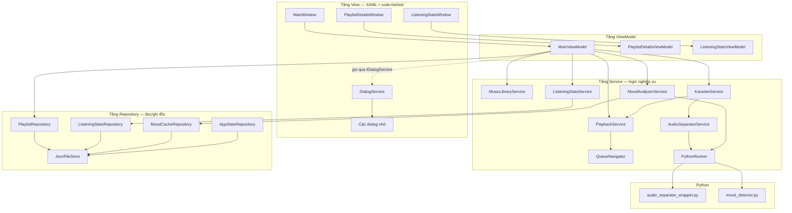

# 🏗️ Kiến trúc code — tài liệu chuẩn bị demo

Tài liệu giải thích cấu trúc dự án và **file nào chịu trách nhiệm cho chức năng nào**, để trả lời
được câu hỏi "chỗ này code ở đâu?" trong lúc demo.

---

## 1. Tổng quan

| | |
|---|---|
| Nền tảng | C# WPF, .NET 8 (`net8.0-windows`) — chỉ chạy trên Windows |
| Kiến trúc | MVVM + service layer sau interface, dependency injection thủ công |
| Quy mô | ~7.800 dòng (C# + XAML + Python) |
| Lưu trữ | JSON trong `%APPDATA%\WpfMusicPlayer\` — không dùng database |
| AI | Hai script Python được gọi từ C# qua `Process` |

**Thư viện NuGet**

| Gói | Dùng để |
|---|---|
| NAudio | Giải mã và phát audio |
| TagLibSharp | Đọc/ghi metadata (tên bài, ca sĩ, ảnh bìa) trong file nhạc |
| Microsoft.Toolkit.Mvvm | `ObservableObject`, `RelayCommand`, `AsyncRelayCommand` |
| Ookii.Dialogs.Wpf | Hộp thoại chọn thư mục kiểu Vista |

---

## 2. Cấu trúc thư mục

```
WpfMusicPlayer/
├─ Models/          Dữ liệu thuần — không logic, không phụ thuộc gì
├─ Interfaces/      Toàn bộ hợp đồng (I*.cs) — tầng trên chỉ nhìn thấy chỗ này
├─ Repositories/    Đọc/ghi dữ liệu xuống đĩa
├─ Services/        Logic nghiệp vụ
├─ ViewModels/      Trạng thái và lệnh cho từng cửa sổ
├─ Converters/      Chuyển dữ liệu sang dạng hiển thị
├─ Resources/       Script Python
└─ *.xaml(.cs)      Cửa sổ và hộp thoại
```

Chiều phụ thuộc luôn đi **vào trong**: `ViewModels` → `Interfaces` ← `Services` → `Interfaces` ←
`Repositories`, và mọi tầng đều được phép dùng `Models`.

Điểm mấu chốt: **không tầng nào phụ thuộc trực tiếp vào tầng khác**, tất cả gặp nhau ở `Interfaces`.
Nhờ vậy `Interfaces/` không cần `using` ngược lên `Services/` — các kiểu dùng chung như
`DependencyCheck` hay `AudioProgressEventArgs` được đặt trong `Models/` chứ không nằm lẫn trong
file implementation.

### Interfaces/

| File | Hợp đồng cho |
|---|---|
| `IPlaybackService.cs` | Động cơ phát nhạc và hàng đợi |
| `IMusicLibraryService.cs` | Thư viện nhạc |
| `IListeningStatsService.cs` | Đếm lượt nghe |
| `IKaraokeService.cs` | Chế độ karaoke |
| `IAudioSeparatorService.cs` | Tách giọng hát |
| `IMoodAnalyzerService.cs` | Phát hiện cảm xúc |
| `IDialogService.cs` | Mở cửa sổ / hộp thoại |
| `IPlaylistRepository.cs` | Lưu trữ playlist |
| `IListeningStatsRepository.cs` | Lưu trữ lịch sử nghe |
| `IMoodCacheRepository.cs` | Lưu trữ kết quả cảm xúc |
| `IAppStateRepository.cs` | Lưu trữ trạng thái ứng dụng |

### Repositories/

| File | Ghi xuống |
|---|---|
| `JsonFileStore.cs` | Lớp dùng chung: đọc/ghi một file JSON, không bao giờ để file hỏng làm chết app |
| `PlaylistRepository.cs` | `playlists.json` + `covers/` |
| `ListeningStatsRepository.cs` | `listening_stats.json` |
| `MoodCacheRepository.cs` | `moods.json` |
| `AppStateRepository.cs` | `app_state.json` |

`JsonFileStore<T>` là chỗ gom lại phần lặp: xác định đường dẫn `%APPDATA%`, cấu hình serializer,
và quy tắc *file hỏng thì trả về rỗng chứ không ném lỗi*. Trước đây bốn nơi tự viết lại logic này.

---

## 3. Ba tầng



**Quy tắc xuyên suốt: mũi tên chỉ đi một chiều, từ trên xuống.**

- View **không** biết gì về service, chỉ biết ViewModel của mình
- ViewModel **không** biết gì về `Window`, `MessageBox` — muốn mở hộp thoại phải qua `IDialogService`
- Service **không** biết gì về UI — không có dòng `MessageBox.Show` nào trong tầng service
- Service **không** tự đọc/ghi file — việc đó đẩy xuống repository

---

## 4. Luồng khởi động

Đây là câu hỏi hay bị hỏi nhất: *"app bắt đầu chạy từ đâu?"*

```
App.xaml                  → không có StartupUri, cố ý bỏ đi
   ↓
App.xaml.cs OnStartup()   → composition root
   ↓
new AppServices()         → dựng toàn bộ object graph một lần
   ↓
new DialogService(services)
   ↓
new MainViewModel(services, dialogs)
   ↓
new MainWindow(viewModel)  → window.Show()
   ↓
MainWindow_Loaded         → await viewModel.InitializeAsync()
                             (nạp thư viện đã nhớ + khôi phục phiên nghe)
```

`App.xaml` **không** dùng `StartupUri="MainWindow.xaml"` như mặc định của WPF, vì cửa sổ cần được
tiêm phụ thuộc qua constructor. Nếu để `StartupUri`, WPF sẽ tự gọi constructor rỗng và không có
cách nào truyền ViewModel vào.

**File:** [App.xaml.cs](WpfMusicPlayer/App.xaml.cs) · [AppServices.cs](WpfMusicPlayer/Services/AppServices.cs)

---

## 5. Bảng tra: chức năng → file

> Đây là phần dùng nhiều nhất khi demo.

### Phát nhạc

| Chức năng | File chính |
|---|---|
| Phát / tạm dừng / dừng / tua | `Services/PlaybackService.cs` |
| Quyết định bài kế tiếp (shuffle, repeat) | `Services/QueueNavigator.cs` |
| Hàng đợi (thêm, xoá, đặt lại) | `Services/PlaybackService.cs` — vùng `#region Queue` |
| Nút bấm trên thanh điều khiển | `ViewModels/MainViewModel.cs` — `PlayPauseCommand`, `NextCommand`... |
| Thanh tiến trình, kéo để tua | `MainWindow.xaml.cs` — `#region Seeking` |
| Phím tắt | `MainWindow.xaml` (`Window.InputBindings`) + `MainWindow.xaml.cs` (`Window_PreviewKeyDown`) |

### Thư viện nhạc

| Chức năng | File chính |
|---|---|
| Quét thư mục, đọc tag | `Services/MusicLibraryService.cs` — `ScanFolderAsync`, `LoadSongFromFile` |
| Tìm kiếm | `Services/MusicLibraryService.cs` — `Search` |
| Sửa metadata, ghi ngược vào file | `Services/MusicLibraryService.cs` — `UpdateMetadata` |
| Thu nhỏ ảnh bìa | `Services/ImageUtils.cs` |
| Kéo-thả file vào cửa sổ | `MainWindow.xaml.cs` — `#region Drag and drop` → `MainViewModel.AddDroppedPathsAsync` |
| Hộp thoại sửa bài hát | `SongEditDialog.xaml` + `.xaml.cs` |

### Playlist

| Chức năng | File chính |
|---|---|
| Tạo, xoá, thêm/bớt bài, lưu JSON | `Repositories/PlaylistRepository.cs` |
| Nối lại tham chiếu bài sau khi quét | `Repositories/PlaylistRepository.cs` — `RelinkTo` |
| Cửa sổ chi tiết playlist | `ViewModels/PlaylistDetailsViewModel.cs` + `PlaylistDetailsWindow.xaml` |
| Hộp thoại đặt tên / chọn ảnh bìa | `PlaylistNameDialog.xaml` + `.xaml.cs` |
| Hộp thoại chọn nhiều bài để thêm | `SongSelectionDialog.xaml` + `.xaml.cs` |
| Hộp thoại chọn playlist đích | `PlaylistSelectionDialog.xaml` + `.xaml.cs` |

### Thống kê nghe

| Chức năng | File chính |
|---|---|
| Đếm lượt nghe (ngưỡng 75%) | `Services/ListeningStatsService.cs` |
| Lưu lịch sử xuống đĩa | `Repositories/ListeningStatsRepository.cs` |
| Gom nhóm theo tuần / tháng / toàn thời gian | `Services/ListeningStatsService.cs` — `GetStatsForPeriod` |
| Cửa sổ thống kê | `ViewModels/ListeningStatsViewModel.cs` + `ListeningStatsWindow.xaml` |

### Karaoke — tách giọng hát (AI)

| Chức năng | File chính |
|---|---|
| Điều phối: tách → đổi nguồn phát → quay lại | `Services/KaraokeService.cs` |
| Gọi script, đọc tiến trình, quản lý file stems | `Services/AudioSeparatorService.cs` |
| Tách audio bằng model ONNX | `Resources/audio_separator_wrapper.py` |
| Nút 🎤, overlay tiến trình, nút Cancel | `ViewModels/MainViewModel.cs` — `#region Karaoke` |
| Màu nút theo trạng thái | `Converters/Converters.cs` — `KaraokeStateToBrushConverter` |

### Phát hiện cảm xúc (AI)

| Chức năng | File chính |
|---|---|
| Chạy script, phân tích JSON | `Services/MoodAnalyzerService.cs` |
| Cache kết quả xuống đĩa | `Repositories/MoodCacheRepository.cs` |
| Thuật toán phân tích | `Resources/mood_detector.py` |
| Kiểu dữ liệu cảm xúc | `Models/Mood.cs` |
| Nút phân tích, tạo playlist theo cảm xúc | `ViewModels/MainViewModel.cs` — `#region Mood detection` |
| Hiển thị cột Mood | `Converters/Converters.cs` — `MoodToTextConverter`, `MoodToBrushConverter` |

### Hạ tầng dùng chung

| Chức năng | File chính |
|---|---|
| Tìm Python, chạy tiến trình, kiểm tra thư viện | `Services/PythonRunner.cs` |
| Nhớ trạng thái giữa các lần chạy | `Repositories/AppStateRepository.cs` |
| Đọc/ghi JSON dùng chung | `Repositories/JsonFileStore.cs` |
| Mở cửa sổ / hộp thoại thay cho ViewModel | `DialogService.cs` + `Services/IDialogService.cs` |
| Dựng toàn bộ object graph | `Services/AppServices.cs` |

---

## 6. Chi tiết từng tầng

### 6.1 Models — `Models/`

Dữ liệu thuần, không có logic nghiệp vụ.

| File | Nội dung |
|---|---|
| `Song.cs` | Một bài hát. Kế thừa `ObservableObject` nên UI tự cập nhật khi đổi tên/lượt nghe/cảm xúc |
| `Playlist.cs` | Một playlist. Tự phát tín hiệu khi số bài thay đổi |
| `Enums.cs` | `RepeatMode` (Off/RepeatAll/RepeatOne), `PlaybackState` |
| `ListeningStats.cs` | Bản ghi phiên nghe và các lớp tổng hợp thống kê |
| `Mood.cs` | Enum `Mood` 4 giá trị + lớp `MoodAnalysis` kèm các chỉ số đo được |

**Điểm đáng nói khi demo — `Song` định danh bằng gì:**

```csharp
private string IdentityKey =>
    string.IsNullOrEmpty(FilePath) ? Id : FilePath.ToLowerInvariant();
```

`Equals` và `GetHashCode` **cùng dùng một khoá này**. Trước đây `Equals` so cả `Id` lẫn `FilePath`
nhưng `GetHashCode` chỉ dùng `Id` → hai object "bằng nhau" mà khác mã băm, phá vỡ hợp đồng của
`Dictionary` và `HashSet`. Đường dẫn file được chọn làm khoá vì `Id` là `Guid` sinh mới mỗi lần
quét, không bền qua các lần khởi động.

### 6.2 Services — `Services/`

Mỗi service một trách nhiệm, tất cả đứng sau interface.

#### `PlaybackService.cs` (461 dòng) — động cơ phát nhạc

Sở hữu `IWavePlayer` và `AudioFileReader` của NAudio, cộng với hàng đợi.

| Thành phần | Vai trò |
|---|---|
| `LoadFile` | Nạp file, tạo player mới, gắn sự kiện |
| `PlaySongAtIndex` | Chuyển bài, có cờ `_isSwitchingTrack` chống gọi lồng nhau |
| `OnPlaybackStopped` | Bài hết → tự sang bài kế |
| `SwapSource` | Đổi file audio **mà không đổi bài hiện tại** — dùng cho karaoke |
| `PrepareAt` | Nạp bài và đặt con trỏ vào vị trí cũ **mà không phát** — dùng khi khôi phục phiên |
| `_positionTimer` | `DispatcherTimer` 100ms, phát sự kiện cập nhật vị trí |

Cờ `_suppressAutoAdvance` giải quyết một vấn đề tinh tế: khi ta chủ động dừng player cũ để nạp
bài mới, NAudio cũng phát sự kiện `PlaybackStopped`. Nếu không phân biệt, app sẽ tưởng bài vừa
kết thúc và nhảy sang bài kế → mỗi lần chuyển bài lại bị nhảy cóc một bài.

#### `QueueNavigator.cs` (258 dòng) — luật shuffle và repeat

Tách riêng khỏi `PlaybackService` vì đây là **logic thuần**: không audio, không UI, chỉ trả lời một
câu hỏi — *"vị trí tiếp theo trong hàng đợi là số mấy?"*. `Next()` và `Previous()` trả về `int?`,
`null` nghĩa là dừng phát.

Shuffle và repeat **độc lập** với nhau, giống Spotify: shuffle đổi thứ tự, repeat quyết định điều
gì xảy ra ở hai đầu thứ tự đó.

**Điểm đáng nói khi demo:** khi bật shuffle, bài đang phát được đưa lên **đầu** thứ tự đã xáo:

```csharp
var position = _shuffleOrder.IndexOf(CurrentIndex);
(_shuffleOrder[0], _shuffleOrder[position]) = (_shuffleOrder[position], _shuffleOrder[0]);
_shuffleIndex = 0;
```

Nếu không làm vậy, con trỏ shuffle nằm ở đúng chỗ bài hiện tại trong mảng ngẫu nhiên — bài đó rơi
vào vị trí thứ 3 trong 5 thì chỉ nghe thêm được 2 bài là hết vòng. Ngoài ra khi lặp sang vòng mới,
thứ tự được xáo lại và bài vừa nghe xong không được đứng đầu.

#### `MusicLibraryService.cs` (242 dòng) — thư viện nhạc

Quét thư mục đệ quy, đọc tag bằng TagLib, tìm kiếm, ghi metadata ngược vào file.

Hai chi tiết đáng nói:

**Gom lô khi quét.** Thêm từng bài một vào `ObservableCollection` nghĩa là mỗi bài một lần chuyển
ngữ cảnh sang UI thread. Ở đây gom `BatchSize = 50` rồi mới đẩy lên một lần.

**Ảnh bìa được thu nhỏ.** `ImageUtils.CreateThumbnail` giảm ảnh xuống cạnh dài 200px. Ảnh bìa nhúng
trong tag thường 1000×1000 trở lên; giữ nguyên cho cả nghìn bài tốn hàng trăm MB RAM cho những
điểm ảnh không bao giờ được hiển thị.

Đi kèm là một cạm bẫy đã xử lý: `UpdateMetadata` chỉ ghi ảnh vào file **khi người dùng thực sự đổi
ảnh** (`albumArtChanged`). Nếu không, sửa mỗi cái tiêu đề cũng sẽ ghi đè ảnh gốc chất lượng cao
bằng bản thu nhỏ.

#### `Repositories/PlaylistRepository.cs` (263 dòng) — lưu trữ playlist

JSON trong `%APPDATA%`. Ảnh bìa lưu **thành file riêng** trong `covers/`, không nhúng base64 vào
`playlists.json` — nhúng làm file phình vài trăm KB mỗi playlist, mà file này bị ghi lại toàn bộ
mỗi lần thêm một bài.

Bài hát trong playlist chỉ lưu **đường dẫn + metadata tối thiểu**, không lưu ảnh. `RelinkTo` chạy
sau khi quét thư viện, thay các object tạm bằng chính instance trong thư viện — nhờ vậy sửa tên
bài hay tăng lượt nghe ở đâu cũng thấy ở đó.

#### `Services/ListeningStatsService.cs` (298 dòng) — đếm lượt nghe

Một lượt được tính khi vượt **75%** bài hát. Sự kiện `PlayCounted` bắn ngay tại thời điểm đó nên
cột Plays nhảy số tức thì.

Hai chi tiết đáng nói:

**Đo bằng `Stopwatch`, không phải `DateTime`.** Đồng hồ hệ thống có thể bị chỉnh giữa chừng;
`Stopwatch` là đồng hồ đơn điệu nên không bị ảnh hưởng. Ngoài ra khoảng cách lớn hơn
`MaxCreditPerUpdate` (1 giây) bị bỏ qua — đó là lúc app bị pause hoặc máy ngủ, không phải đang nghe.

**Khoá theo đường dẫn file, không theo `Song.Id`.** Bản cũ khoá theo `Id` — vốn được sinh ngẫu
nhiên lại sau mỗi lần quét — nên toàn bộ lịch sử trở thành mồ côi ngay khi khởi động lại app.

#### `Services/AudioSeparatorService.cs` (183 dòng) — tách giọng hát

Gọi `audio_separator_wrapper.py`, phân tích các dòng `Progress: N%`, quản lý thư mục stems.

Tên thư mục stems = tên bài đã làm sạch + **8 ký tự hash MD5 của đường dẫn đầy đủ**. Phần đọc được
bị cắt còn 30 ký tự, nên nếu không có hash thì hai bài có 30 ký tự đầu giống nhau sẽ ghi đè kết quả
của nhau.

#### `Services/MoodAnalyzerService.cs` (229 dòng) — phát hiện cảm xúc

Gọi `mood_detector.py`, nhặt dòng bắt đầu bằng `MOOD_RESULT` ra khỏi stdout rồi parse JSON.

Phải dùng tiền tố đánh dấu vì librosa và các thư viện phụ thuộc in khá nhiều thứ khác ra stdout —
không thể giả định dòng cuối cùng là kết quả.

Kết quả cache vào `moods.json` theo đường dẫn file. Mỗi bài chỉ phân tích một lần trong đời.

#### `PythonRunner.cs` (211 dòng) — hạ tầng Python dùng chung

Cả hai tính năng AI đều dùng chung lớp này.

| Method | Vai trò |
|---|---|
| `FindPython` | Chạy `python --version`, cache kết quả bằng `Lazy<T>` |
| `RunAsync` | Chạy script, **đọc song song cả stdout lẫn stderr** |
| `CheckModulesAsync` | Thử `import` từng thư viện, báo đúng thứ đang thiếu |

**Điểm quan trọng nhất của cả file — và là một lỗi thật đã từng có:**

```csharp
process.Start();
process.BeginOutputReadLine();
process.BeginErrorReadLine();
await process.WaitForExitAsync(cancellationToken);
```

Nếu bật `RedirectStandardOutput` mà **không đọc** stream, bộ đệm pipe của hệ điều hành sẽ đầy, và
tiến trình Python bị chặn vĩnh viễn ở lệnh `print` tiếp theo. Script tách nhạc in rất nhiều dòng
nên chắc chắn gặp. Bản cũ redirect nhưng không bao giờ đọc.

`CheckModulesAsync` in `sys.executable` **trước** các lệnh import, nên khi thiếu thư viện vẫn báo
được app đang dùng interpreter nào — hữu ích khi máy có nhiều bản Python cùng lúc.

#### Các service còn lại

| File | Vai trò |
|---|---|
| `Services/KaraokeService.cs` | Điều phối giữa `AudioSeparatorService` và `PlaybackService` |
| `Repositories/AppStateRepository.cs` | Nhớ thư mục nhạc, âm lượng, hàng đợi, vị trí phát |
| `Services/ImageUtils.cs` | Thu nhỏ ảnh bìa |
| `Services/AppServices.cs` | Composition root — nơi duy nhất `new` các service |

### 6.3 ViewModels — `ViewModels/`

| File | Vai trò |
|---|---|
| `MainViewModel.cs` (880 dòng) | Toàn bộ logic của cửa sổ chính |
| `PlaylistDetailsViewModel.cs` | Cửa sổ chi tiết playlist |
| `ListeningStatsViewModel.cs` | Cửa sổ thống kê |

`MainViewModel` chia theo `#region` để dễ tìm: `Startup and shutdown`, `Library`, `Playlists`,
`Songs and transport`, `Karaoke`, `Mood detection`, `Shared job plumbing`.

Mọi hành động trên UI đều là một **command**, không phải event handler:

```csharp
ScanMusicCommand = new AsyncRelayCommand(ScanMusicAsync);
KaraokeCommand   = new AsyncRelayCommand(ToggleKaraokeAsync, () => !IsBusy);
```

Tham số thứ hai là `CanExecute` — khi đang chạy một tác vụ nặng, các nút liên quan tự động mờ đi,
không cần viết tay dòng nào để bật/tắt.

**Phần dùng chung giữa hai tính năng AI:** `RunJobAsync` bọc overlay, `CancellationTokenSource`,
bắt lỗi và dọn dẹp. Cả tách nhạc lẫn phân tích cảm xúc đều đi qua nó, nên tính năng mood tự động
có sẵn thanh tiến trình và nút Cancel mà không phải viết lại.

### 6.4 Views — file `.xaml` và `.xaml.cs`

| File | Vai trò |
|---|---|
| `MainWindow.xaml` (643 dòng) | Giao diện chính, style, binding |
| `MainWindow.xaml.cs` (216 dòng) | Chỉ việc thuộc về view |
| `PlaylistDetailsWindow`, `ListeningStatsWindow` | Bind vào ViewModel tương ứng |
| `SongEditDialog`, `SongSelectionDialog`, `PlaylistNameDialog`, `PlaylistSelectionDialog` | Dialog khép kín, dùng code-behind + `DialogResult` |
| `App.xaml` | Style ScrollBar / ScrollViewer / ListBox / ListView dùng chung |

**Vì sao code-behind vẫn còn?** MVVM không có nghĩa là code-behind phải rỗng. Những gì còn lại
trong `MainWindow.xaml.cs` đều là việc **thuần view**, không phải logic nghiệp vụ:

- Tính lại độ rộng cột khi đổi kích thước cửa sổ
- Xử lý kéo thanh tiến trình (phải tháo binding trong lúc kéo, nếu không con trỏ bị giật về mỗi 100ms)
- Kéo-thả file
- Chặn phím `Space` khi con trỏ đang ở trong ô tìm kiếm
- Chuyển double-click thành lệnh gọi command

**Một bài học đáng kể khi demo:** ban đầu tôi làm double-click bằng `MouseBinding` trong
`InputBindings` cho "đúng MVVM":

```xml
<!-- CÁCH NÀY KHÔNG CHẠY -->
<MouseBinding MouseAction="LeftDoubleClick"
              Command="{Binding PlaySongCommand}"
              CommandParameter="{Binding SelectedItem, ElementName=SongsListView}"/>
```

`InputBindings` **không nằm trong cây logic của WPF**, nên binding `ElementName` không có namescope
để phân giải → `CommandParameter` luôn là `null` → command chạy nhưng không làm gì, **không báo lỗi
gì cả**. Giải pháp là quay lại `MouseDoubleClick` trong code-behind. Đây là ví dụ tốt cho việc tuân
thủ khuôn mẫu một cách máy móc có thể tệ hơn là chọn giải pháp đơn giản.

Các dialog nhỏ giữ code-behind là **cố ý**: chúng khép kín, không có logic nghiệp vụ, và `DialogResult`
là cơ chế sẵn có của WPF. Bọc thêm ViewModel cho chúng chỉ tăng số file chứ không tăng giá trị.

### 6.5 Converters — `Converters/Converters.cs`

Cầu nối giữa dữ liệu và cách hiển thị.

| Converter | Chuyển đổi |
|---|---|
| `ByteArrayToImageConverter` | `byte[]` → ảnh hiển thị được |
| `TimeSpanToSecondsConverter` | `TimeSpan` ↔ giây, cho thanh trượt |
| `TimeSpanToTextConverter` | `TimeSpan` → `3:45` |
| `PlaybackStateToSymbolConverter` | Trạng thái phát → ▶️ / ⏸️ |
| `ShuffleToStringConverter`, `RepeatModeToStringConverter` | Chế độ → icon |
| `ActiveToggleToBrushConverter` | Chế độ đang bật → màu xanh |
| `KaraokeStateToBrushConverter` | Trạng thái karaoke → trong suốt / xanh lá / cam |
| `MoodToTextConverter`, `MoodToBrushConverter` | Cảm xúc → nhãn và màu |
| `EmptyStringToVisibilityConverter` | Ô nhập rỗng → hiện chữ mờ gợi ý |
| `ListViewItemIndexConverter` | Dòng → số thứ tự |

### 6.6 Python — `Resources/`

#### `audio_separator_wrapper.py` (274 dòng)

Nhận `<file audio> <thư mục ra> --name <tên thư mục>`, dùng thư viện `audio-separator` với model
ONNX `UVR-MDX-NET-Inst_HQ_3`, xuất `vocals.wav` và `accompaniment.wav`.

Tham số `--name` để C# và Python **thống nhất tên thư mục** mà không phải viết lại quy tắc đặt tên
ở cả hai phía.

#### `mood_detector.py` (224 dòng)

Đây là script đáng để giải thích kỹ khi demo.

**Ý tưởng.** Đặt bài hát lên hai trục mà tâm lý học âm nhạc dùng:

- **valence** — nghe *tích cực* đến đâu
- **arousal** — nghe *kích thích* đến đâu

Bốn góc phần tư thành bốn cảm xúc:

|  | Tích cực | U tối |
|---|---|---|
| **Năng lượng cao** | 🙂 Happy | ⚡ Energetic |
| **Năng lượng thấp** | 🌙 Calm | 💧 Sad |

**Đo gì.** Phân tích 90 giây ở **giữa** bài (đoạn intro và outro hiếm khi đại diện cho cả bài):

| Đặc trưng | Hàm librosa | Ý nghĩa |
|---|---|---|
| Tempo | `beat.beat_track` | Nhanh hay chậm |
| Độ to | `feature.rms` | Mạnh hay nhẹ |
| Độ chói | `feature.spectral_centroid` | Sáng hay trầm ấm |
| Tông trưởng/thứ | `feature.chroma_cqt` | Vui hay buồn |

**Nhận diện tông** bằng **Krumhansl-Schmuckler key profiles**: đối chiếu phân bố cao độ của bài với
cả 12 phép xoay của hai mẫu chuẩn trưởng và thứ, lấy tương quan cao nhất. Độ tin cậy của phép đoán
được dùng làm trọng số — tông mơ hồ thì không được phép chi phối kết luận.

**Cách chấm điểm.** Không có model huấn luyện nào, chỉ là tổ hợp có trọng số:

```python
AROUSAL_WEIGHTS = {"loudness": 0.30, "tempo": 0.50, "brightness": 0.20}
VALENCE_WEIGHTS = {"mode": 0.55, "brightness": 0.25, "tempo": 0.20}
```

Hai lựa chọn trọng số này **có lý do, không phải chọn bừa** — và đều đến từ việc chạy thử trên nhạc
thật:

- **Tempo nặng hơn độ to** trong trục năng lượng, vì độ to phản ánh cách *master* bản thu nhiều hơn
  là bản chất bài hát. Nhạc thương mại hiện đại bị nén rất to (đo được RMS 0.15–0.33 trên thư viện
  thật, trong khi dải sách vở là 0.02–0.20), nên nếu để độ to dẫn dắt thì **mọi bài đều bị xếp vào
  nửa năng lượng cao**.
- **Trọng số tông phải lớn hơn 0.5**, vì một bài chậm, ấm, tông trưởng rõ ràng chính là định nghĩa
  của "êm dịu". Với trọng số nhỏ hơn 0.5 thì dù tông trưởng đến mấy cũng không bao giờ vượt được
  ngưỡng, và mọi bài êm dịu đều bị đọc thành buồn.

**Giới hạn cần nói thẳng khi demo:** script chỉ nghe âm thanh, không hiểu lời. Một bài lời buồn
nhưng phối tươi sáng sẽ bị đoán là Happy. Đổi lại, mọi kết luận đều giải thích được — rê chuột lên
cột Mood sẽ thấy đúng tông, BPM và hai chỉ số đã dẫn tới kết luận đó.

---

## 7. Các luồng dữ liệu quan trọng

### 7.1 Phát một bài

```
Double-click dòng
  → MainWindow.SongsListView_MouseDoubleClick
  → MainViewModel.PlaySongCommand
  → PlaybackService.PlaySongFromCollection(song, DisplayedSongs)
      → SetQueue(...)            đặt hàng đợi
      → PlaySongAtIndex(index)
          → QueueNavigator.SetCurrent(index)
          → LoadFile(...)        NAudio nạp file
          → Play()
          → sự kiện TrackStarted
              → ListeningStatsService.OnSongStarted(song)
```

### 7.2 Đếm một lượt nghe

```
DispatcherTimer 100ms trong PlaybackService
  → sự kiện PositionChanged
  → MainViewModel → ListeningStatsService.OnPositionUpdate(...)
      → cộng dồn thời gian nghe thật (Stopwatch)
      → vượt 75%? → sự kiện PlayCounted
          → MainViewModel tìm bài trong thư viện → song.ViewCount++
              → Song là ObservableObject nên cột Plays tự cập nhật
```

Khi bài dừng hoặc chuyển bài, `SaveCurrentSession()` ghi bản ghi phiên xuống
`listening_stats.json`.

### 7.3 Bật karaoke

```
Bấm 🎤 → MainViewModel.ToggleKaraokeAsync
  → đã có stems chưa? (KaraokeService.StemsExist)
      có  → KaraokeService.EnableAsync → PlaybackService.SwapSource(accompaniment.wav)
      chưa → EnsureDependenciesAsync    kiểm tra Python + audio-separator + ffmpeg
           → RunJobAsync                hiện overlay, tạo CancellationToken
           → AudioSeparatorService.SeparateAudioAsync
               → PythonRunner.RunAsync  chạy script, đọc từng dòng stdout
                   → khớp "Progress: N%" → cập nhật thanh tiến trình
               → xong → SwapSource(...)
```

Điểm cần nhấn: `SwapSource` **không đổi bài hiện tại**, chỉ đổi file audio đang phát và giữ nguyên
vị trí con trỏ. Nhờ vậy chuyển qua lại giữa bản gốc và bản không lời không bị gián đoạn.

### 7.4 Phân tích cảm xúc

```
Bấm 🧠 → MainViewModel.AnalyzeMoodAsync
  → đã có trong cache? → hiện ngay, không chạy Python
  → chưa → EnsureMoodDependenciesAsync   kiểm tra numpy + librosa + ffmpeg
        → RunJobAsync                    overlay dùng chung với karaoke
        → MoodAnalyzerService.AnalyzeAsync
            → PythonRunner.RunAsync → mood_detector.py
            → nhặt dòng "MOOD_RESULT {...}" → parse JSON
            → song.Mood = ...  (cột Mood tự cập nhật)
            → ghi moods.json
```

---

## 8. Dữ liệu được lưu ở đâu

Tất cả nằm trong `%APPDATA%\WpfMusicPlayer\`, **không có database**:

| File / thư mục | Nội dung | Do file nào quản lý |
|---|---|---|
| `playlists.json` | Playlist (đường dẫn bài + metadata tối thiểu) | `Repositories/PlaylistRepository.cs` |
| `covers/` | Ảnh bìa playlist | `Repositories/PlaylistRepository.cs` |
| `listening_stats.json` | Lịch sử nghe, số lượt phát | `Repositories/ListeningStatsRepository.cs` |
| `moods.json` | Kết quả phân tích cảm xúc | `Repositories/MoodCacheRepository.cs` |
| `app_state.json` | Thư mục nhạc, âm lượng, hàng đợi, vị trí phát | `Repositories/AppStateRepository.cs` |
| `stems/` | File vocals và accompaniment đã tách | `Services/AudioSeparatorService.cs` |

Đặt ngoài thư mục `bin/` là **có chủ đích**: kết quả tách nhạc tốn 5–15 phút mỗi bài, để trong
`bin/` thì mỗi lần Clean hoặc Rebuild là mất sạch.

---

## 9. Những câu có thể bị hỏi khi demo

**"Vì sao dùng MVVM?"**
Để logic tách khỏi giao diện. Cụ thể trong dự án này: `MainWindow.xaml.cs` giảm từ 973 xuống 216
dòng, và những gì còn lại đều là việc thuần view. Toàn bộ logic nghiệp vụ nằm ở ViewModel và service,
nơi có thể đọc và sửa mà không phải mở trình thiết kế giao diện.

**"Interface để làm gì, sao không gọi thẳng class?"**
Để tầng trên phụ thuộc vào *hợp đồng* chứ không phải *cách hiện thực*. `MainViewModel` chỉ biết
`IPlaybackService` có method `Play()`, không biết bên dưới là NAudio hay gì khác. Muốn đổi thư viện
audio thì chỉ sửa một class, không đụng tới ViewModel.

**"Vì sao tách `QueueNavigator` ra khỏi `PlaybackService`?"**
Vì luật shuffle/repeat là logic thuần, không liên quan gì đến audio. Tách ra thì đọc được nó một
mình, và cũng chính nhờ tách ra mà phát hiện được lỗi shuffle không đi hết mọi bài.

**"Vì sao gọi Python thay vì làm hết bằng C#?"**
Hệ sinh thái AI cho âm thanh nằm ở Python — `audio-separator`, `librosa`, `onnxruntime`. Viết lại
bằng C# là làm lại từ đầu công sức nhiều năm của cộng đồng. C# đóng vai điều phối: gọi tiến trình,
đọc tiến trình, xử lý hủy và lỗi.

**"Nếu máy không có Python thì sao?"**
App vẫn chạy đầy đủ mọi chức năng nghe nhạc. Chỉ hai tính năng AI báo thiếu — và báo **đúng thứ
đang thiếu** kèm lệnh cài, chứ không im lặng thất bại.

**"Dữ liệu lưu ở đâu, sao không dùng database?"**
JSON trong `%APPDATA%`. Quy mô dữ liệu là vài nghìn bản ghi, đọc lên một lần lúc khởi động — thêm
một database vào đây chỉ tăng phụ thuộc mà không giải quyết vấn đề gì có thật.

**"Chỗ nào khó nhất?"**
Ba chỗ, và đều là loại lỗi *im lặng*:
1. Đọc pipe của tiến trình Python — không đọc thì Python treo vĩnh viễn, không báo gì
2. `MouseBinding` trong `InputBindings` — `ElementName` không phân giải được, command chạy với
   tham số `null` mà không báo lỗi
3. Hiệu chỉnh thang đo cảm xúc — code chạy đúng, chỉ là kết quả sai, phải chạy trên nhạc thật mới
   phát hiện ra

---

## 10. Đọc code theo thứ tự nào

Nếu cần nắm nhanh trước khi demo, đọc theo thứ tự này:

1. `App.xaml.cs` → `Services/AppServices.cs` — hiểu app dựng lên như thế nào (60 dòng)
2. `Models/Song.cs` — đơn vị dữ liệu trung tâm
3. `Services/QueueNavigator.cs` — logic thuần, dễ đọc nhất, hiểu ngay luật shuffle/repeat
4. `Services/PlaybackService.cs` — động cơ phát nhạc
5. `ViewModels/MainViewModel.cs` — đọc theo `#region`, không cần đọc hết một lượt
6. `MainWindow.xaml` — xem các binding trỏ ngược về đâu trong ViewModel
7. `Resources/mood_detector.py` — nếu định demo phần cảm xúc
